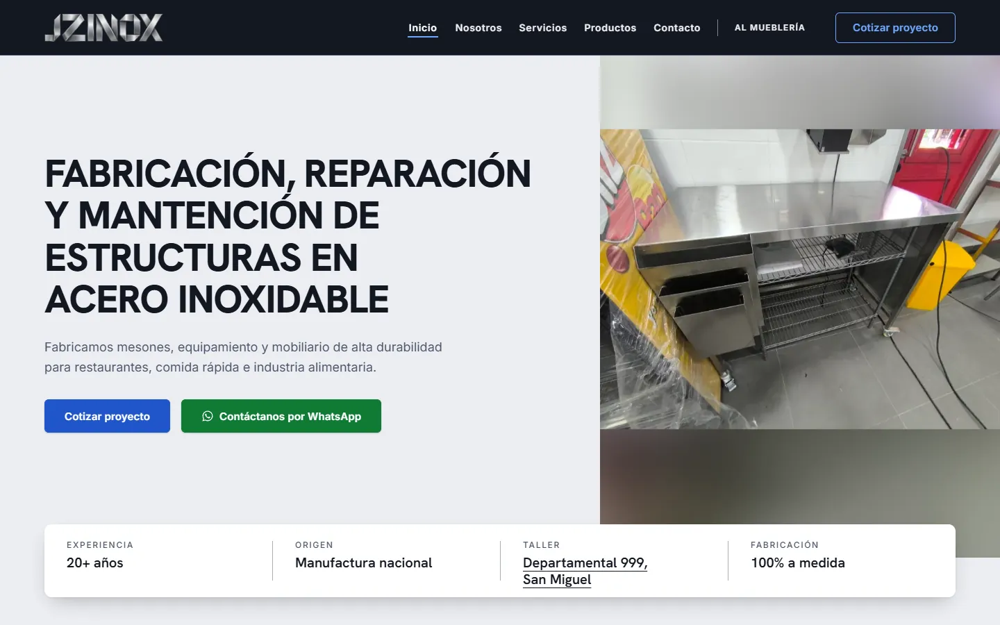
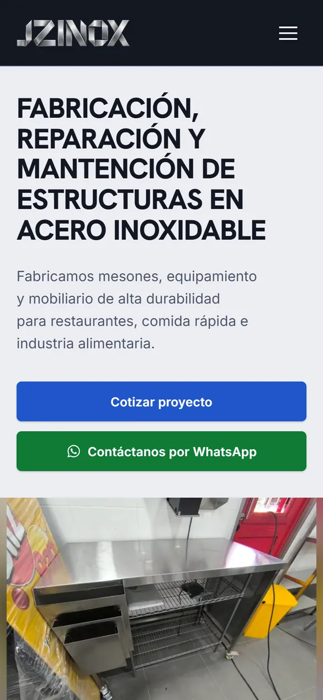
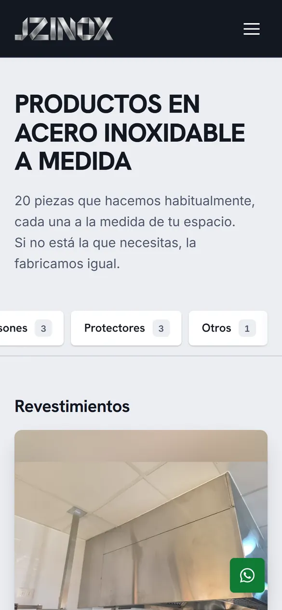
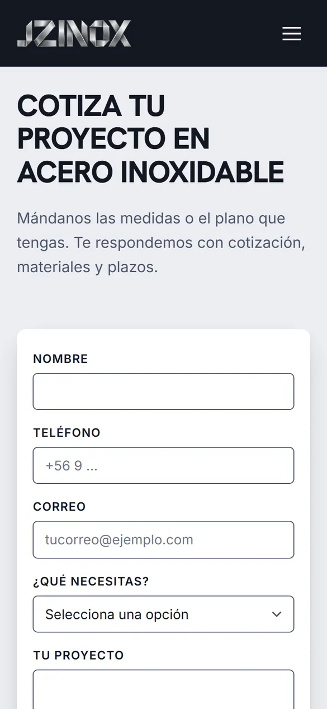
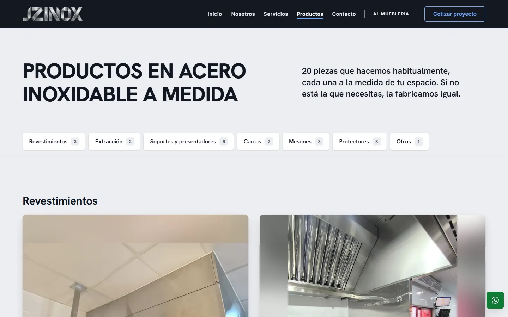

# JZ INOX · Sitio corporativo

Sitio web de **JZ INOX**, taller de fabricación, reparación y mantención en acero inoxidable de
San Miguel (Santiago de Chile) que equipa cocinas de restaurantes, comida rápida e industria
alimentaria. Incluye una página propia para su marca aliada **AL Mueblería** (muebles a medida).

**En producción:** https://jzinox.vercel.app · Proyecto para cliente real, diseñado y desarrollado
por [Fabián Guerra](https://github.com/FabianGuerra20).



<p>
  
  
  
</p>

## El encargo

El taller necesitaba presentar sus servicios y un catálogo de piezas a medida, y recibir
cotizaciones **sin publicar precios**. Se trabajó por etapas, con entregas revisadas por el
cliente: maqueta, textos, fotos, elección de diseño y material final.

## Qué se construyó

- **Páginas:** Inicio, Nosotros, Servicios, Productos (catálogo), Contacto, AL Mueblería y una
  página de soldadura para la búsqueda local «soldadura santiago». Además: gracias, privacidad
  y 404.
- **Catálogo de 20 piezas** en 7 categorías: galería de varias fotos por producto, barra de
  categorías que marca dónde estás, visor de fotos y cotización por WhatsApp en cada pieza.
- **Formulario de contacto** con validación accesible, adjuntos y errores escritos para
  personas.
- **Selector de diseño para el cliente** (`scripts/generar-selector.mjs`): un solo HTML con el
  sitio completo y paneles para elegir paleta, modo, letras, portada, listado, estilo y
  esquinas. El cliente eligió ahí el diseño actual y lo envió por WhatsApp.
- **Videos del taller** en bucle y sin sonido, que solo se reproducen cuando están a la vista.



## Decisiones de diseño

- **Paleta «Azul arco» en modo claro**, elegida por el cliente, con cabecera y pie oscuros. El
  azul se reserva para acciones y estados.
- **Estilo blando:** tarjetas sin borde, con sombra suave y esquinas de 10 px, aplicado a todo
  el sitio.
- **Fotos siempre enteras:** casi todas son fotos verticales de celular. En vez de recortarlas,
  se muestran completas sobre una versión desenfocada de sí mismas (miniatura de 24 px en
  base64, para no descargar dos veces cada foto).
- **Todo lo que abre WhatsApp lo dice**, va en verde y lleva su ícono.
- **Contenido con procedencia:** cada texto en `src/data/` está marcado como `[PDF]` (literal
  del cliente), `[CLIENTE]` (instrucción suya) o `[PROPUESTA]` (redactado por mí, pendiente de
  validar). No se inventan cifras, clientes ni garantías.

El sistema completo está en [`DESIGN.md`](DESIGN.md).

## Calidad verificada

- **QA automática con Playwright + Edge** en 11 páginas a 390, 768, 1100 y 1440 px: sin
  desbordes, sin errores de consola y sin controles táctiles bajo 44 px.
- Contraste AA calculado en todo el texto.
- Movimiento solo con `transform`, `opacity` y `clip-path`, una sola curva de aceleración y
  todo reducido con `prefers-reduced-motion`.
- SEO técnico: título y descripción propios por página, datos estructurados (`LocalBusiness`,
  `FAQPage`, `BreadcrumbList`), sitemap, URLs sin barra final y redirecciones 301.
- En laboratorio, LCP entre 0,2 y 0,8 s y CLS de 0 en todas las páginas.

Los hallazgos y arreglos de cada revisión están en [`CHANGELOG.md`](CHANGELOG.md).

## Tecnología

Astro 7 (sitio estático) · CSS nativo con tokens, sin framework de UI ni Tailwind · fuentes
propias, sin terceros · Lenis para el desplazamiento suave (solo con mouse) · Vercel.

## Comandos

| Comando | Qué hace |
|---|---|
| `npm install` | Instala dependencias |
| `npm run dev` | Servidor de desarrollo |
| `npm run build` | Genera el sitio estático en `dist/` |
| `npm run preview` | Sirve `dist/` localmente |
| `node scripts/agregar-foto.mjs <original> <nombre>` | Convierte una foto a WebP, crea sus variantes y la registra |
| `node scripts/generar-desenfoque.mjs` | Regenera los fondos desenfocados de las fotos |
| `npm run build && node scripts/generar-selector.mjs` | Arma el selector de diseño para el cliente |

Requiere Node 22.12 o superior.

## Estructura

```
src/
  pages/        index · nosotros · servicios · catalogo · contacto · al-muebleria
                soldadura-santiago · gracias · privacidad · 404 · blog
  components/   Header · Footer · Seo · BrandShowcase (carrusel) · MediaPair
                ClientLogos · FloatingContact · WeldingCursor · Analytics
  layouts/      Layout.astro (cabecera, pie, menú, visor de fotos)
  data/         site · company · brands · services · catalog · welding (todo el contenido)
  styles/       global.css (tokens, componentes compartidos, movimiento)
public/
  img/          fotos en WebP con variantes
  video/        videos del taller (mp4 sin audio, con portada)
scripts/        fotos, desenfoque y selector de diseño
docs/capturas/  imágenes de este README
```

## Documentación

- [`DESIGN.md`](DESIGN.md): sistema de diseño y decisiones.
- [`CHANGELOG.md`](CHANGELOG.md): qué se hizo y cuándo.
- [`MEJORAS.md`](MEJORAS.md): pendientes técnicos y de SEO.
- [`SEO-LOCAL.md`](SEO-LOCAL.md): pasos para la ficha de Google y el posicionamiento local.
- [`CLAUDE.md`](CLAUDE.md): reglas de trabajo del proyecto (también para asistentes de código).

## Derechos

El código se publica como muestra de trabajo. Los textos, fotos, logotipos y marcas son de
JZ INOX y de sus clientes, y no se pueden reutilizar.
